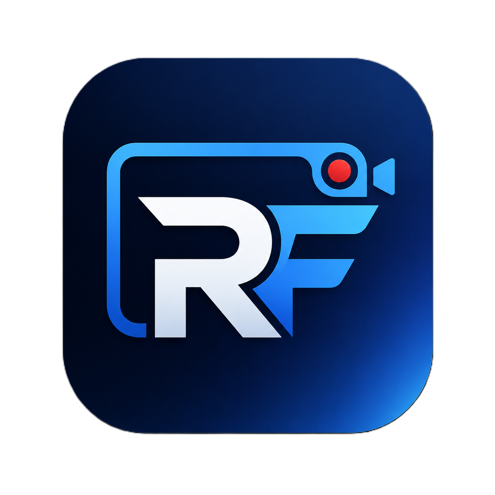

<p align="center">
  
</p>

<h1 align="center">RecordFlow</h1>

<p align="center">
  A 100% free, privacy-first Windows screen recorder and post-recording studio for screen, window, area, independent webcam, microphone, and system audio — built to stay out of your recording and render locally.
</p>

<p align="center">
  <a href="https://github.com/Waqar-743/RecordFlow/releases/latest">
    
  </a>
</p>

---

## Why RecordFlow Exists

RecordFlow started with a simple idea: screen recording and demo polishing should feel calm, fast, local, and completely free. No accounts, no watermarks, no subscriptions, and zero cloud uploads — your footage is captured and rendered directly on your computer.

Whether you are recording a tutorial, a product walkthrough, a bug report, or a presentation, RecordFlow stays invisible to Windows screen capture (`WDA_EXCLUDEFROMCAPTURE`), tracks your cursor and clicks at 60 Hz, records your webcam as an independent synchronized track, and opens straight into a non-destructive studio editor when you stop recording.

## Download (Free for Windows)

Get the latest Windows installer from the [RecordFlow releases page](https://github.com/Waqar-743/RecordFlow/releases/latest).

Direct release assets:

- [Download EXE installer (`RecordFlow_1.2.0_x64-setup.exe`)](https://github.com/Waqar-743/RecordFlow/releases/latest/download/RecordFlow_1.2.0_x64-setup.exe)
- [Download MSI installer (`RecordFlow_1.2.0_x64_en-US.msi`)](https://github.com/Waqar-743/RecordFlow/releases/latest/download/RecordFlow_1.2.0_x64_en-US.msi)

## Highlights

- **Streamlined Studio Shell & Multi-Theme System**:
  - Opens maximized into a clutter-free desktop workspace with a top navigation bar (**Record / Edit** switcher, **Open project**, **Save project**, **Theme Selector**, **Script** teleprompter toggle, and **Shortcuts**) plus a dismissible alert banner for system or hotkey conflict notices.
  - **8 Dynamic Themes**: Switch live between **Graphite**, **Ember**, **Paper**, **Daylight**, **Midnight**, **Nord**, **Rosé**, and **Forest** with instant surface/canvas updates and session persistence.
- **Screen, Area & Window Capture Modes**:
  - **Screen**: Live display preview with floating status and resolution badge (`Ready · 1920 × 1080`) and multi-monitor switching.
  - **Area**: Automatically hides/minimizes RecordFlow and opens a full-screen translucent region selector with live pixel dimensions, 8 resize handles, and `Esc` to cancel and restore.
  - **Window**: Queries active Windows applications with a scrollable, searchable **Choose a window** list, live window thumbnails, and an isolated `"Only this window is recorded"` target state.
- **Pre-Recording Controls & Screen-Share Picker**:
  - Dedicated cards for **Microphone** (On/Off, device selection, live Web Audio VU meter), **Camera** (On/Off, live mini preview, independent synchronized video stream), and **Countdown** (`Off / 3s / 5s`).
  - Bottom action bar with **Hide app while recording**, **System audio** WASAPI loopback toggle, and a **Screen-Share Source Picker** modal supporting **Window** and **Entire Screen** tabs with live thumbnails and **Share with system audio**.
- **60 Hz Cursor & Click Tracking + Independent Webcam Layer**:
  - Tracks mouse movement and click events at 60 Hz (`.cursor.json`) and records your webcam into a separate synchronized track (`.cam.mp4`) so you can reposition, resize, reshape, or toggle the camera overlay non-destructively after recording.
- **Post-Recording Edit Studio**:
  - Automatically opens your captured footage in the **Edit** workspace inside a presentation canvas with rounded corners, subtle drop shadow, and background padding.
  - **Canvas**: Aspect ratio presets (`16:9 Landscape`, `9:16 Vertical`, `1:1 Square`, `4:5 Portrait`, `Original`), `Fit` vs `Fill` framing, 18 curated backgrounds (gradients, abstract meshes, scenic wallpapers, solid tones), and **Custom Image** upload.
  - **Camera**: Quick-snap positions (`Top-Left`, `Top-Right`, `Bottom-Left`, `Bottom-Right`, `Center-Edge`) plus direct drag-and-drop on the canvas, scale, shape (`Circle`, `Rounded`, `Square`), corner radius, horizontal mirror, border, shadow, and visibility toggle.
  - **Zoom, Cursor, Audio & Blur**: One-click auto-zoom from tracked clicks, zoom intensity presets (`Subtle`, `Balanced`, `Close`), click-to-aim focus, enhanced cursor overlay with click ripples & spotlight halo, mic/system/master audio mixer with fade-in/out, and draggable privacy blur regions.
  - **Interactive Timeline**: Play/Pause (`Space`), timecode, editable & draggable Trim Start/End handles, audio waveform + zoom keyframe track, and bottom-right **Export** button.
- **Local Export Modal**:
  - Focused **Export video** dialog (*"Rendered on this computer. Nothing is uploaded."*) with selectable cards for **Format** (`MP4`, `WebM`), **Resolution** (`4K`, `1440p`, `1080p`, `720p`), **Frame Rate** (`60 fps`, `30 fps`), and **Quality** (`Best`, `High`, `Small`), real-time progress, and local file saving.
- **Presenter Script Teleprompter (Invisible in Capture)**:
  - Always-on-top script window protected with `WDA_EXCLUDEFROMCAPTURE` so you can read your notes while recording without viewers ever seeing it.

## Default Global Shortcuts

| Action | Default Shortcut | Notes |
| :--- | :--- | :--- |
| **Start / Stop Recording** | `Alt + Shift + R` | Works even when minimized or in the system tray |
| **Pause / Resume Recording** | `Alt + Shift + P` | Works during active recording |

All shortcuts can be customized inside **Shortcuts** in the top toolbar.

## System Requirements

- Windows 10 version 1903 (build 18362) or later (64-bit).
- 4 GB RAM minimum, 8 GB recommended.
- 250 MB free disk space for installation, plus room for recordings.

Optional hardware:

- Webcam for picture-in-picture camera overlay.
- Microphone for voice commentary.

## Development

```bash
git clone https://github.com/Waqar-743/RecordFlow.git
cd RecordFlow
npm install
npm run tauri dev
```

Build a production Windows installer:

```bash
npm run tauri -- build
```

## Technology

- **Frontend**: React 19, TypeScript, Vite, Tailwind CSS, HTML5 Canvas2D, WebCodecs (`mp4-muxer` / `webm-muxer`)
- **Desktop Core**: Tauri v2 & Rust
- **Screen & Window Capture**: Windows Graphics Capture API (`windows-capture`) + GDI thumbnails
- **Video & Audio Encoding**: Windows Media Foundation (hardware-first H.264 + AAC)
- **Audio Capture**: `cpal` (microphone input + Windows WASAPI system audio loopback)
- **Camera Capture**: `nokhwa` (dedicated background thread + independent `.cam.mp4` track)
- **Interaction Tracking**: Win32 60 Hz cursor & click sampler (`.cursor.json`)
- **System Integration**: Tauri v2 System Tray, Global Shortcuts, File System & Native Dialogs

### Built with care — 100% free and open source
